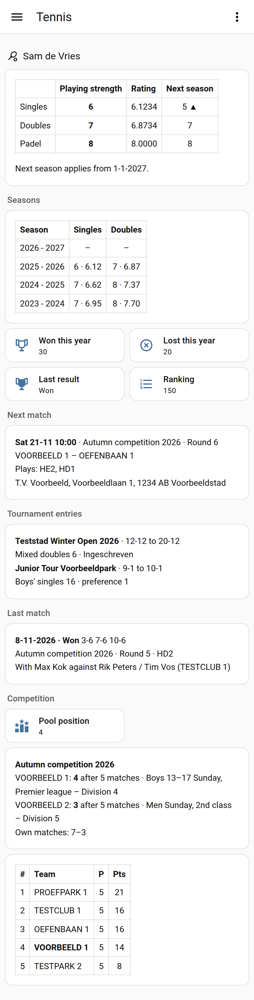

# Tenniscompetitie for Home Assistant

A [Home Assistant](https://www.home-assistant.io/) integration, installable through [HACS](https://hacs.xyz/),
for Dutch tennis (and padel): the KNLTB rating and playing strength, results, competition teams,
ranking and matches of the players you follow.

Tenniscompetitie is an independent project, **not affiliated with or endorsed by the KNLTB**; its name
says what it is about, not who made it. The data comes from MijnKNLTB, the KNLTB's player site.

> **Status: early development (0.1.0).** It works, but has not been released or used much yet.
> Expect changes. Feedback welcome, see [Contributing](#contributing).

## What it does

Log in with a MijnKNLTB account (any KNLTB member's), then add players: yourself, your children, a
partner. Per player you get a device with:

| Entity | State | Details (attributes) |
|---|---|---|
| **Singles rating** / **Doubles rating** | the KNLTB DSS rating, e.g. `6.1234` | playing strength (*speelsterkte*, 1–9), the playing strength from next season once published (and its date and trend), this season's start rating and number of rated matches, and every season's start and end rating |
| **Padel rating** | the padel DSS rating | the same, for padel (only for players with a padel rating) |
| **Matches won this year** / **Matches lost this year** | a number | singles, doubles and mixed separately, career totals, win percentage |
| **Last result** | won or lost | the last five results with their dates |
| **Last match** | its date | tournament or competition, round, opponents, partner, score, venue, duration |
| **Next match** | its start time | the next match of the player's competition teams or a planned tournament match: round, draw, partner, opponents, venue; for a team match also home or away, the venue's address and location, the line-up and which matches the player plays (once the captain has set it) |
| **Tournament entries** | the number of upcoming entries | per tournament: dates, location, events, status (*Ingeschreven*, *Geaccepteerd*, …) and the Junior Tour preference; only for the account's own player |
| **Competition position** | the team's position in its pool | competition, team, category and class, points, the whole pool standing (played, won, drawn, lost, points, rubbers, sets, games, form), all the player's teams with their standings, the player's win-loss |
| **Ranking** | position in the first ranking list | list and category, best position, points, the other lists the player is in |
| **Match today** | on all day on days with a match | the first match (by start time) and how many there are |
| **Match update** (event) | fires on a change | *result* (of the player's match), *new match* (planned in a tournament, or a team match coming up), *rescheduled*, *team result*, *new playing strength* (next season's), *rating changed* — with the details of the match or rating |
| **Matches** (calendar) | on during a match | the player's competition team matches (with the venue) and tournament matches (with start times once planned), and entered tournaments as all-day blocks until their matches are known |

- Lower is better for playing strengths (1 is the best). The *trend* is `up` when next season's
  playing strength is better than the current one.
- **Rating history:** the integration reads the rating after every rated match of past seasons
  (once, in the background) and fills Home Assistant's long-term statistics with it, so a
  statistics graph of the rating shows years, not just the time since the integration was added.
  Seasons before 2021 use another scale on the site and are left out.
- Competition team matches last 5 hours in the calendar and tournament matches 2 hours (the site
  gives start times only); tournament matches without a time are all-day events.
- Early in the year, before the new competitions start, last year's competitions are shown.
- **Planned tournament matches** are not on a player's profile until they have been played. They
  are on the tournament's own pages, which the integration finds through the account's entries
  (*Mijn inschrijvingen*), for tournaments that are running or start within 14 days (Junior Tour
  ones included); during a tournament it updates every 30 minutes. Entries are only visible to the
  member who logged in, so for other followed players the calendar has their competition matches
  but not their tournaments.
- Change alerts also catch what changed while Home Assistant was off: the integration remembers
  each player's matches and ratings as it last saw them. The first update only records.
- Dutch and English.

### Actions

- `tenniscompetitie.get_matches`: a player's matches (their own, planned ones included, and their
  teams'), optionally only the upcoming ones, as a response. For scripts, dashboards and voice
  assistants.
- `tenniscompetitie.get_standings`: the pool standings of the player's competition teams.

### Blueprints

Ready-made automations that send a notification to your phone (Home Assistant app), in Dutch or English:

| Blueprint | What it does | |
|---|---|---|
| Notify on match updates | a result, a new or moved match, a team's final score, next season's playing strength, a changed rating |  |
| Reminder before a match | a set time before the next match, with the opponents or teams, the venue and address, and the player's matches in a team match |  |
| Match day summary | at a set time on match days: today's matches with times, opponents and venues |  |

## How it works, and the catch

The data comes from [MijnKNLTB](https://mijnknltb.toernooi.nl), the KNLTB's player site on the
Tournament Software platform. It has no API and since 2026 requires a login, so the integration logs
in with your account and reads the pages, as a browser would. It accepts only the necessary cookies.
How the site works is described in [docs/api.md](docs/api.md).

The project is not affiliated with the KNLTB or Tournament Software. When the site changes,
the integration may need an update: it then shows a repair (*Settings → Repairs*) and the sensors that
depend on the changed page become unavailable, while the rest keep working. If the KNLTB asks us to
change or stop something, we will.

MijnKNLTB has no tokens: the login cookie lasts 7 days, after which the integration logs in again.
That is why the password is stored in Home Assistant (like every other integration that logs in with a
password). If the password changes, Home Assistant asks for the new one.

It polls gently: every 3 hours, and every 30 minutes on days with (or the day before) a match or
during an entered tournament. One update reads 4–10 pages per player, one at a time; pages that
change slowly (pool standings, the next team match) are reused for a few hours. Reading the rating
history of past seasons takes a few dozen pages once, in the background.

**Privacy.** Ratings and results are personal data, often of minors. The integration only fetches the
players you add, keeps their data in your Home Assistant, and never sends it anywhere else. The
diagnostics (for bug reports) contain no names, member numbers or profile ids.

## Installation

Requires Home Assistant 2025.12 or newer.

**HACS** (since Home Assistant 2026.11 part of the built-in *Marketplace*): add
`https://github.com/sebegerritsen/ha-tenniscompetitie` as a custom repository of type *Integration*,
install **Tenniscompetitie** and restart Home Assistant.

**Manually:** copy `custom_components/tenniscompetitie` into the `custom_components` folder of your Home
Assistant configuration and restart Home Assistant.

Then *Settings → Devices & services → Add integration → Tenniscompetitie*: log in with your MijnKNLTB login
name (or member number or email address) and password, and choose whether to follow your own profile.
Add more players with **Add player** on the integration's page: search by name, pick the player.

## Example dashboard

[examples/dashboard.yaml](examples/dashboard.yaml) is a dashboard with a section per player: the
playing strengths and ratings with next season's, the seasons so far, win-loss, the last result,
the next match with its venue and line-up, tournament entries, the last match, the competition with
its pool standing, the ranking, the rating over the past five years and the calendar. Paste
it into a new dashboard's raw configuration editor and replace `sam_de_vries` with your player's
entity names.

## Contributing

Issues and pull requests are welcome, in English or Dutch. Planned work is tracked in the
[issues](../../issues).

- [docs/api.md](docs/api.md) describes how the site works and what is parsed.
- [tools/probe.py](tools/probe.py) fetches a page with your own account, without Home Assistant.
- Tests: `pip install -r requirements_test.txt`, then `pytest`. Lint with `ruff check` and
  `ruff format`.
- The parsers are tested against saved pages in `tests/fixtures`, with every name, number, id and
  club replaced by made-up values. **Never commit real names, member numbers, ratings or results.**
  `python3 tools/check_fixtures.py` checks the fixtures for leftovers (CI runs it too); give it a
  private list of the real names you replaced with `--blocklist`.

## License

[MIT](LICENSE)
